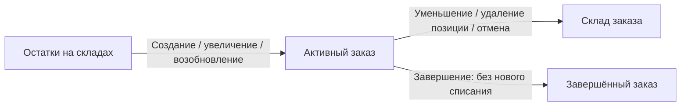
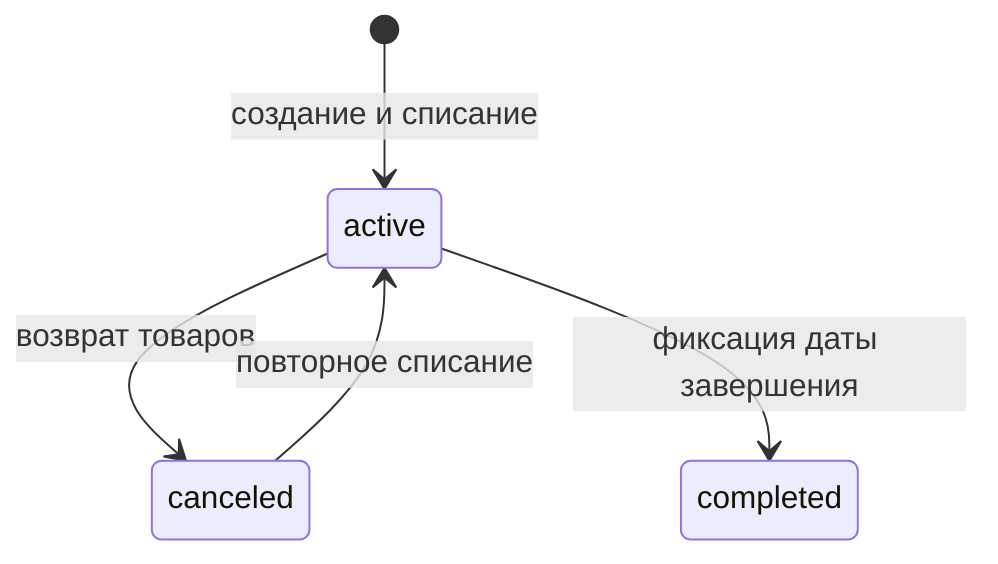
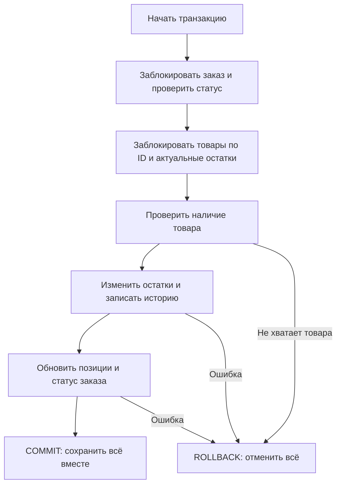
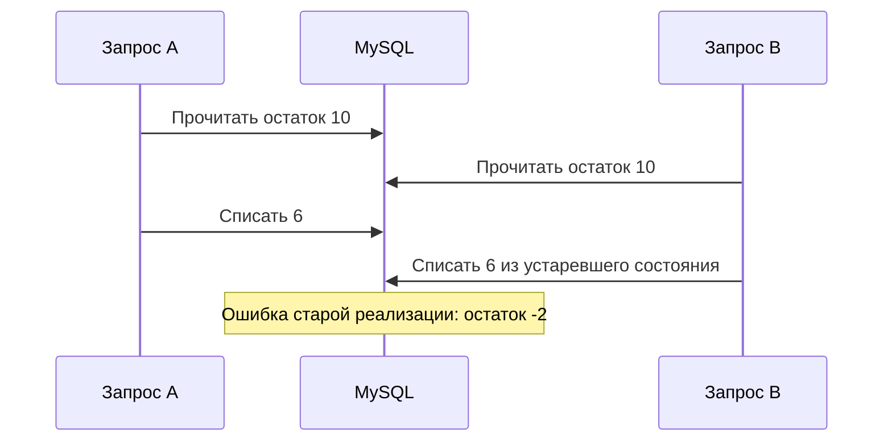
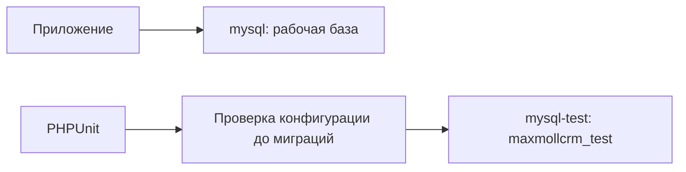

# Склад: что, как и зачем

## Движение товара — действующие правила



Товар списывается при создании, поэтому завершение не должно списывать его повторно.
Возврат идёт на склад заказа: исходные склады могут отличаться.
Каждое реальное движение записывается в history_stocks.
Разница количества 0 означает отсутствие движения — не создаём ни остаток, ни историю.

## Статусы — действующие правила



Редактирование разрешено только для active. Из completed обратного перехода нет.
Повторная отмена и повторное возобновление должны отклоняться без изменения остатков.

## Транзакция — реализованное поведение



Транзакция нужна, чтобы ошибка на второй позиции не оставляла возврат первой позиции.
Блокировка заказа нужна, чтобы два запроса не отменили один заказ дважды.
Блокировка остатков нужна, чтобы разные заказы не списали один и тот же товар.
Единый порядок блокировок уменьшает риск взаимной блокировки многопозиционных заказов.
Уникальный ключ товар/склад нужен, чтобы конкурентные возвраты не создавали дубли.
Эти изменения реализованы. Дополнительно блокируется строка товара: она существует даже тогда, когда остатка ещё нет. Это защищает конкурентные возвраты от дублей. Обратная сторона — движения одного товара на разных складах выполняются последовательно.

## Почему простой транзакции недостаточно



Теперь второй запрос ждёт освобождения блокировки, читает актуальные 4
и отклоняет списание 6. Конкурентные PHPUnit-тесты проверяют это двумя независимыми соединениями MySQL; тест дожидается обоих запросов у блокировки до её освобождения.

## Где запускаются тесты



Тестовая MySQL не публикует порт на Windows и хранит данные в tmpfs.
Перезапуск контейнера очищает её данные. Рабочая MySQL использует прежний каталог.
Параметры PHPUnit принудительно направляют подключение на mysql-test.
Дополнительная проверка в tests/TestCase.php отклоняет другую БД ещё до RefreshDatabase.

Из корня репозитория:

```powershell
docker compose --profile test up -d --wait mysql-test
docker compose exec -T php php artisan test
```

PHP-контейнер должен быть запущен, зависимости Composer установлены.
Не запускать migrate:fresh вручную на рабочей базе.
Тест HTTP проверяет существующий /api/v1/test; корневого маршрута / в API нет.
Служебные каталоги Laravel восстановлены и сохраняются через .gitignore; кеширование представлений проверено в Docker.
