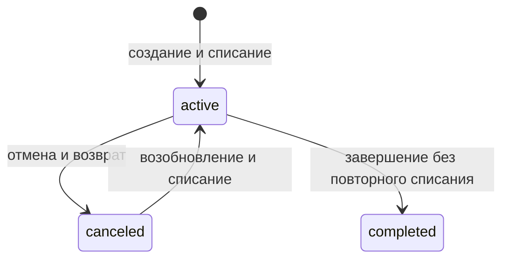

# MaxmollCRM

Backend API для управления заказами и складскими остатками на **PHP 8.2 и Laravel 12**.
Проект для портфолио PHP/Laravel Developer с акцентом на целостность данных:
списание и возврат товаров, транзакции MySQL и обработку конкурентных запросов.

## Возможности

- Создание и редактирование заказа с несколькими товарными позициями.
- Отмена, возобновление и завершение заказа с проверкой допустимых статусов.
- Учёт остатков на нескольких складах и история движения товаров.
- Поиск заказов по покупателю, фильтр по статусу и пагинация.
- Валидация входных данных и демонстрационные данные через сидеры.

Это API-проект: пользовательского интерфейса нет. Основная демонстрация — HTTP-запросы и тесты.

## Технические решения

| Задача | Решение и причина |
| --- | --- |
| Не допустить частичного списания или возврата | Остатки, история, позиции и статус сохраняются в транзакции; ошибка откатывает всю операцию |
| Не продать один остаток двум заказам | Чтение актуального состояния через `SELECT ... FOR UPDATE` до проверки наличия |
| Не отменить заказ дважды | Блокировка строки заказа до проверки статуса и выполнения движения |
| Безопасно вернуть товар в отсутствующий остаток | Блокировка строки товара сериализует создание строки товар/склад |
| Защитить данные на уровне БД | Уникальные пары товар/склад и заказ/товар, `CHECK (stock >= 0)`, внешние ключи |
| Уменьшить риск deadlock | Единый порядок блокировок товаров и складов; до трёх попыток транзакции при взаимной блокировке |
| Проверить поведение при гонках | Два независимых PHP-процесса и соединения MySQL, синхронизация у удерживаемой блокировки |

Блокировка товара — осознанный компромисс: движения одного товара на разных складах выполняются последовательно.
Такой подход упрощает корректность при текущем масштабе проекта; высокая пропускная способность не измерялась.

## Стек и структура

PHP 8.2 · Laravel 12 · MySQL 8 / InnoDB · Eloquent ORM · PHPUnit 11 · Docker Compose · nginx

```text
maxmollcrm/app/
├── Http/Controllers/     HTTP-операции
├── Http/Requests/        Валидация запросов
├── Actions/Order/        Отмена, возобновление и завершение заказа
├── Models/              Модели и складские операции
└── QueryBuilders/       Фильтры выборок
maxmollcrm/tests/         Функциональные и конкурентные проверки
maxmollcrm/database/      Миграции, фабрики и сидеры
docker/                  PHP, Composer и nginx
requests/                Готовые HTTP-запросы
```

Существующая архитектура сохранена: Controller → Model/Action → MySQL.
Отдельные слои репозиториев и универсальные сервисы не добавлялись.

### Код для просмотра

- [Stock](maxmollcrm/app/Models/Stock.php) — актуальные остатки, блокировки и атомарная история движений.
- [OrderController](maxmollcrm/app/Http/Controllers/OrderController.php) и [Actions/Order](maxmollcrm/app/Actions/Order) — границы транзакций и переходы статусов.
- [Миграция ограничений](maxmollcrm/database/migrations/2026_11_13_000001_protect_stock_and_order_item_integrity.php) — инварианты БД и проверка существующих данных.
- [StockConcurrencyTest](maxmollcrm/tests/Feature/StockConcurrencyTest.php) — воспроизведение гонок на независимых соединениях MySQL.
## Быстрый запуск

Нужны Git, Docker Desktop в режиме Linux-контейнеров и Docker Compose v2 или новее.
Локальные PHP, Composer, MySQL и Node.js для запуска API не нужны.
Команды ниже — для PowerShell на Windows.

```powershell
git clone https://github.com/fe11fire/maxmollcrm.git
cd maxmollcrm
Copy-Item maxmollcrm/.env.example maxmollcrm/.env

docker compose build
docker compose run --rm composer install --no-interaction --prefer-dist
docker compose up -d --wait mysql php nginx

docker compose exec -T php php artisan key:generate
docker compose exec -T php php artisan migrate --force
docker compose exec -T php php artisan db:seed --force
```

Копирование `.env`, генерация ключа и сидирование предназначены для первой установки.
При обновлении существующего проекта сохраните `.env` и ключ; примените только новые миграции.
Повторное сидирование добавляет демонстрационные данные. `migrate:fresh` удаляет таблицы — для обычного запуска он не нужен.

Проверка API:

```powershell
Invoke-RestMethod http://localhost:8000/api/v1/warehouses
Invoke-RestMethod http://localhost:8000/api/v1/stocks
```

Корневой маршрут `/` не предусмотрен. Базовый адрес API: `http://localhost:8000/api/v1`.
Сидеры создают 5 складов, 15 товаров и случайные остатки; готовых заказов нет.
Для создания заказа выберите товар с положительным остатком из `/stocks`.

### Подключения и остановка

| Сервис | Адрес с Windows | Внутри Docker |
| --- | --- | --- |
| API | localhost:8000 | nginx:80 |
| MySQL | localhost:3316 | mysql:3306 |
| phpMyAdmin, необязательно | localhost:9090 | phpmyadmin:80 |

`.env.example` содержит настройки локальной БД: `maxmollcrm`, пользователь `laravel`, пароль `password`.
Рабочие данные сохраняются в `docker/volume/mysql`; обычная остановка `docker compose down` их не удаляет.
Порты 8000 и 3316 должны быть свободны. phpMyAdmin запускается отдельно:

```powershell
docker compose up -d phpmyadmin
docker compose down
```

## Тесты

```powershell
docker compose --profile test up -d --wait mysql-test
docker compose exec -T php php artisan test
```

PHPUnit работает с отдельным контейнером `mysql-test` и БД `maxmollcrm_test`.
Параметры подключения заданы в `phpunit.xml`; `TestCase` проверяет их **до миграций**.
Рабочая БД не очищается. Тестовые данные хранятся в tmpfs и теряются при остановке контейнера.
Suite нужно запускать последовательно: конкурентные тесты сами создают независимые процессы.

Покрыты:

- списание с нескольких складов, точное обнуление и отказ при нехватке;
- возврат, нулевая корректировка и работа с устаревшим объектом модели;
- откат складских изменений при ошибке записи истории и отмены заказа;
- изменение состава заказа, допустимые и повторные переходы статусов;
- валидация количества, повторных товаров и ограничения БД;
- двойное списание, возврат, отмена, возобновление; отмена против завершения и редактирования;
- запуск сидеров.

Конкурентные проверки выполняются на MySQL, а не SQLite. Это проверка корректности блокировок, а не нагрузочное тестирование.

### Подтверждённая проверка

**26 тестов, 167 проверок — проходят в чистой установке Docker.**
На 2026-11-13 проверены сборка без кеша, установка зависимостей из lock-файла,
миграции и сидеры на пустой MySQL, а также полный цикл заказа через HTTP.
Проверка выполнена в отдельном окружении без использования рабочей базы и существующего vendor.
Подробности и версии: [отчёт проверки установки](docs/installation-check.md).

## Пример работы с API

Готовые запросы для REST Client и совместимых инструментов: [requests](requests).
Отправляйте `Accept: application/json` и `Content-Type: application/json`.
Идентификаторы в примерах замените значениями из вашей базы.

Создание — `POST /api/v1/order`:

```json
{
  "customer": "Иван Иванов",
  "warehouse_id": 1,
  "items": [{"id": 1, "count": 2}]
}
```

Изменение — `PUT /api/v1/order`:

```json
{
  "id": 1,
  "items": [{"id": 1, "count": 3}]
}
```

При передаче `items` он заменяет состав заказа: пропущенные товары возвращаются на склад,
`items: []` удаляет все позиции. Отсутствие или `null` сохраняет состав.
Количество — обязательное целое от 1 до 2147483647, каждый товар указывается один раз.

| Метод | Путь после `/api/v1` | Назначение |
| --- | --- | --- |
| GET | /warehouses | Склады |
| GET | /stocks | Товары и остатки |
| GET | /stocks/history | История движения |
| GET | /orders | Заказы; параметры customer, status, page, per_page |
| POST | /order | Создание |
| PUT | /order | Изменение активного заказа |
| PUT | /order/cancel | Отмена и возврат |
| PUT | /order/resume | Возобновление и списание |
| PUT | /order/complete | Завершение |

Тело запроса смены статуса: `{"id": 1}`. Изменения возвращают 200,
ошибки валидации — 422, нехватка товара и недопустимый статус — 400.
Статусы меняются только через PUT; прежние GET-ссылки больше не поддерживаются.

## Бизнес-правила



Редактировать можно только `active`. При создании товар собирается со всех складов,
а при уменьшении позиции или отмене возвращается **на склад заказа**, не обязательно на исходные склады.
Возврат на исходные склады в текущую модель не заложен.

Подробные [схемы транзакций и блокировок](docs/stock-flow.md) и [исходный аудит](docs/stock-audit.md).
Аудит фиксирует состояние до исправлений и сохраняется как история технического разбора.

## Границы проекта

Проект предназначен для локальной демонстрации backend-разработки. Доступ к бизнес-API пока без
аутентификации и разграничения прав; публичный production-запуск требует отдельной подготовки.
CI/CD, нагрузочные испытания и развёртывание на сервере пока не настроены.
Процент покрытия тестами не измерялся.

Миграция ограничений останавливается при существующих дублях или отрицательных остатках:
разбор данных выполняется явно, автоматического удаления или суммирования нет.
MySQL DDL не атомарен; при ошибке применения схемы проверьте её фактическое состояние перед повторным запуском.

Если сохранён кеш старой конфигурации: `docker compose exec -T php php artisan config:clear`.
При диагностике запуска: `docker compose ps` и `docker compose logs --tail=100 php nginx mysql`.

Исходная постановка: [MicroCRM для торговли](https://docs.google.com/document/d/1WSVo8by4D13JUJKpB8m58itoHD_9YVRZXr2zr8sWa_U/edit).
